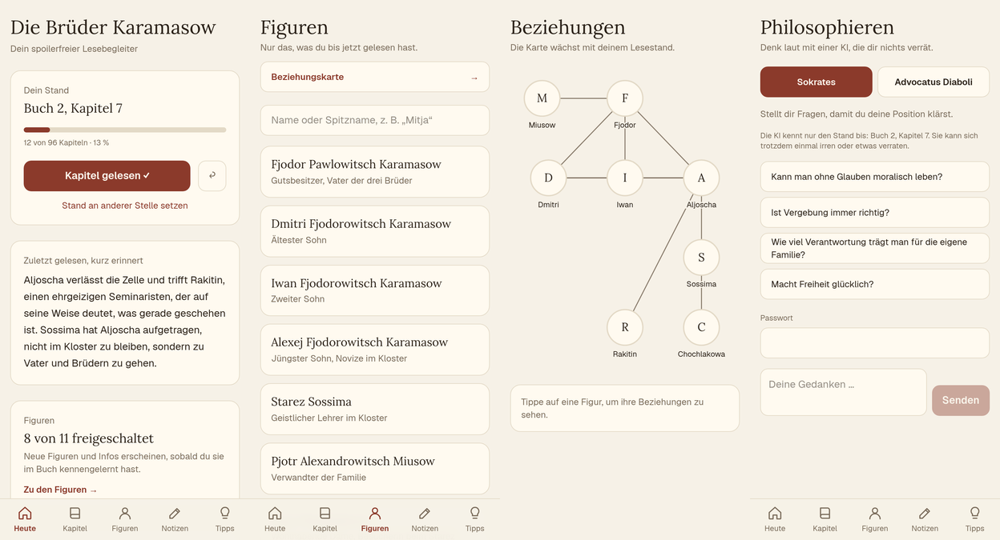
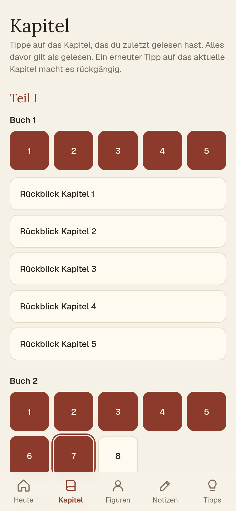
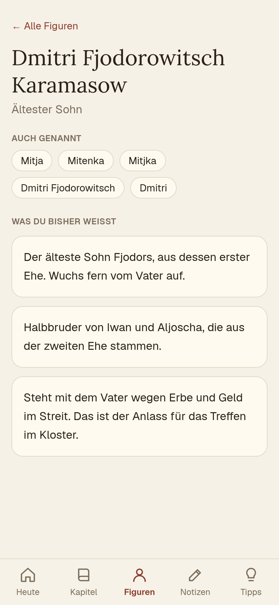
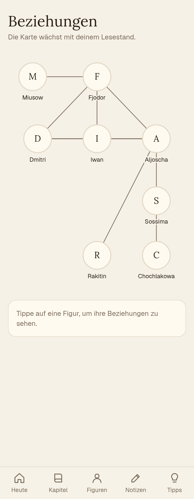
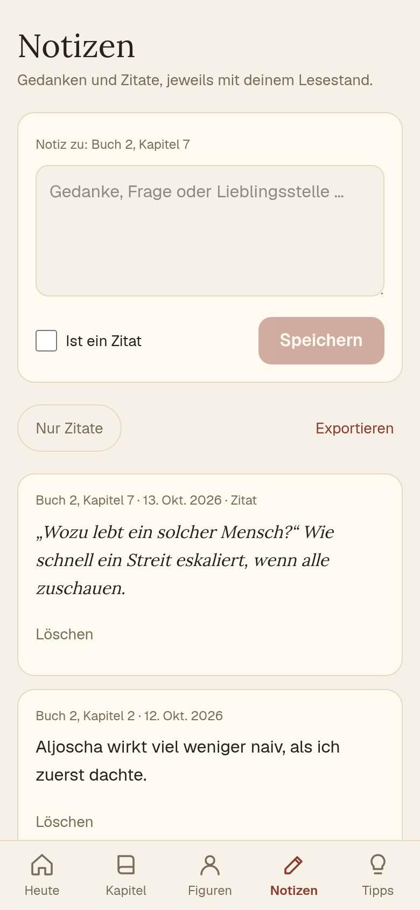
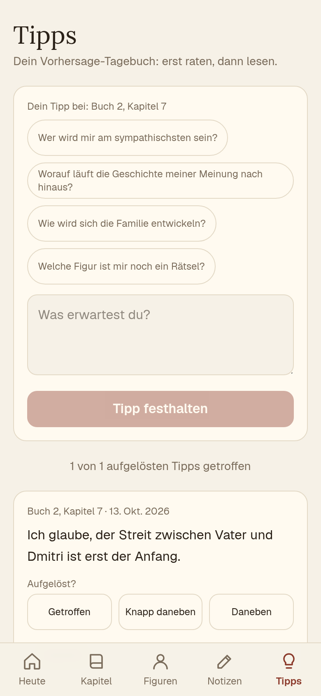
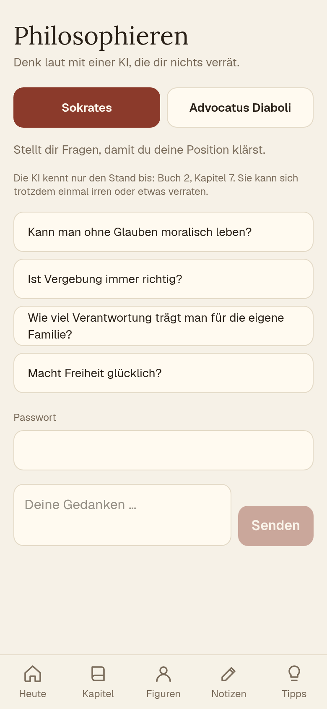
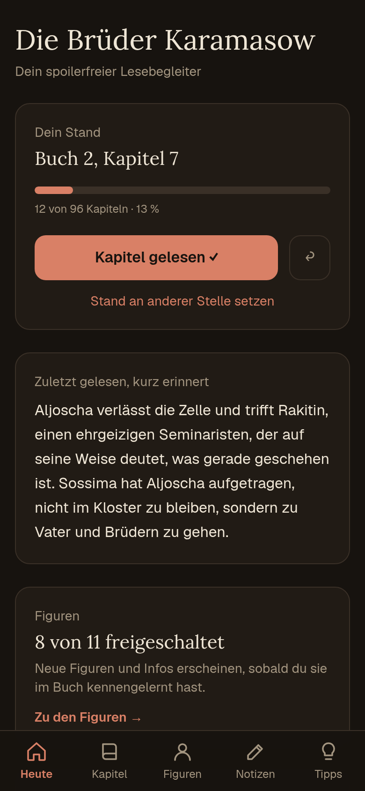
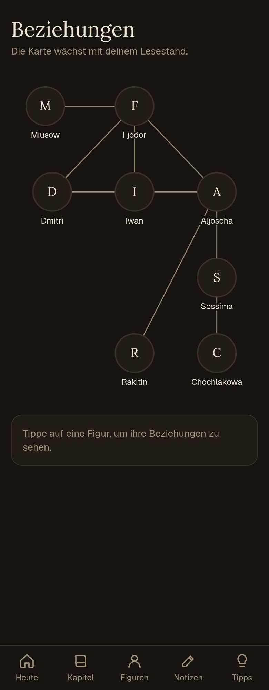

# Karamasow-Begleiter

**Ein spoilerfreier Lesebegleiter für „Die Brüder Karamasow“, gebaut für das Handy.**

Dostojewskis Roman hat über tausend Seiten, Dutzende Figuren und für jede Person drei bis vier Namen. Diese App hilft dir, nicht den Faden zu verlieren, ohne dir etwas zu verraten.

👉 **Live:** https://brueder-karamasow.vercel.app *(auf dem Handy öffnen und „Zum Home-Bildschirm hinzufügen“)*



---

## Die Idee: Fortschritt als Spoiler-Schutz

Statt Spoiler-Warnungen kennt die App nur einen Wert: **wie weit du gelesen hast.**
Jeder Inhalt (jede Figur, jede Info, jede Beziehung, jeder Rückblick) hat einen Freischaltpunkt in Form eines Kapitels. Was dahinter liegt, existiert für dich nicht.

- Du hakst Kapitel ab, und die App wächst mit dir.
- Gesperrte Figuren zeigen nicht einmal ihren Namen.
- Buch- und Kapiteltitel fehlen mit Absicht, weil einige davon Handlung verraten.

## Was die App kann

| | |
|---|---|
|  | **Kapitel.** 13 Bücher, 96 Kapitel als Raster. Ein Tipp setzt deinen Stand, ein zweiter macht ihn rückgängig. Unter jedem Buch stehen aufklappbare Rückblicke auf das, was du gelesen hast. |
|  | **Figuren.** Die Suche kennt Spitznamen: „Mitja“ findet Dmitri. Jede Figurenkarte hat Infos in Stufen, die sich erst beim Lesen öffnen. |
|  | **Beziehungskarte.** Wer gehört zu wem? Die Karte wächst mit deinem Stand, und Beziehungen können sich verändern (z. B. wird aus „Vater und Sohn“ später ein Streit ums Erbe). |
|  | **Notizen.** Gedanken und Zitate, jeweils mit deinem Lesestand. Mit Filter für Zitate und Export als Textdatei. |
|  | **Vorhersage-Tagebuch.** Erst raten, dann lesen, dann prüfen: getroffen, knapp daneben oder daneben. |
|  | **Philosophieren.** Eine KI als *Sokrates* (stellt Fragen) oder *Advocatus Diaboli* (hält dagegen). Sie kennt nur deinen Lesestand. |

Dazu: Dark Mode, Bedienung mit dem Daumen und eine Installation als App mit Offline-Betrieb.

<p>
  
  
</p>

## Die KI und der Spoiler-Schutz

Der Gesprächspartner unter „Philosophieren“ läuft über die Gemini-API (Gratis-Stufe). Er bekommt:

- als Wissen **nur** deine freigeschalteten Figurenkarten und Rückblicke,
- die Anweisung, über Späteres nichts zu sagen oder anzudeuten,
- den Auftrag, eher bei Themen (Glaube und Zweifel, Schuld, Freiheit, Familie) zu bleiben als bei der Handlung.

> **Ehrlich gesagt:** Das Modell kennt das Buch aus dem Training. Der Schutz ist eine Anweisung, keine Garantie. Die App weist darauf hin.

Damit ein öffentlicher Link nicht dein Gratis-Kontingent verbrennt, braucht jede Anfrage ein Passwort. Zusätzlich gibt es eine grobe Begrenzung pro Gerät und pro Tag. Der API-Schlüssel liegt nur auf dem Server und nie im Browser.

## Deine Daten

Lesestand, Notizen und Tipps liegen **nur im Browser deines Geräts** (`localStorage`). Es gibt keinen Account und keine Datenbank. Andere sehen sie nicht, aber Handy und Laptop haben getrennte Daten, und wer den Browser-Speicher löscht, verliert sie. Sichere wichtige Notizen über den Export.

## Technik

- [Next.js](https://nextjs.org) (App Router) mit React und TypeScript
- Tailwind CSS v4, mobile first
- PWA: Manifest, Icons und ein kleiner Service Worker (`public/sw.js`)
- Eine Server-Route (`src/app/api/denken/route.ts`) für die KI
- Hosting auf Vercel

```
src/
├─ books/
│  ├─ types.ts         Datenmodell eines Buchs
│  ├─ registry.ts      Liste aller Bücher
│  └─ karamasow/       Inhalte eines Buchs: Aufbau, Figuren, Beziehungen, Rückblicke
├─ lib/
│  ├─ book.ts          Kapitelzählung (global über alle Abschnitte)
│  ├─ unlock.ts        Freischalt-Logik und Suche
│  ├─ progress.ts      Lesestand pro Buch (localStorage)
│  ├─ keys.ts          Speicherschlüssel und Übernahme alter Daten
│  └─ philosophy.ts    Prompts und Wissensgrenze der KI
├─ components/         Oberfläche
└─ app/                Bibliothek (/), Seiten pro Buch (/[buch]/…) und die KI-Route
```

## Lokal starten

```bash
npm install
npm run dev        # http://localhost:3000
```

Für die KI brauchst du eine `.env.local`:

```
GEMINI_API_KEY=dein-schlüssel     # https://aistudio.google.com/apikey
PHILO_PASSPHRASE=dein-passwort
# optional: GEMINI_MODEL=gemini-3.5-flash-lite
```

Ohne diese Werte läuft der Rest der App normal, nur die KI meldet „noch nicht eingerichtet“.

## Deployen

```bash
npx vercel env add GEMINI_API_KEY production
npx vercel env add PHILO_PASSPHRASE production
npx vercel deploy --prod
```

## Inhalte erweitern

Die Inhalte sind einfache Daten in `src/lib`. Jede Info trägt einen Freischaltpunkt, zum Beispiel `at(2, 4)` für „Buch 2, Kapitel 4“. Eine Info darf nur enthalten, was das Buch bis zu diesem Kapitel selbst preisgibt.

Wichtig: Die Texte sind selbst geschrieben und **aus dem Gedächtnis**, nicht aus einer bestimmten Ausgabe. Kapitelzahlen und Freischaltpunkte können je nach Ausgabe und Übersetzung um ein Kapitel abweichen. Die App ist für die Ausgabe von Hermann Röhl (Anaconda) gedacht, aber noch nicht gegen sie geprüft.

## Urheberrecht

Die App enthält **keinen Text des Romans**. Dostojewskis Original ist gemeinfrei, die deutschen Übersetzungen sind es in der Regel nicht. Alle Texte hier (Figurenkarten, Rückblicke) sind eigene Zusammenfassungen.

## Stand und nächste Ideen

Inhalte gibt es bisher nur bis etwa Buch 3, weil sie mit dem eigenen Lesen mitwachsen. Als Nächstes denkbar: Wortschatz-Karten (Starez, Rubel, Troika), Kontext-Kärtchen zum Russland des 19. Jahrhunderts, ein Quiz zum Gelesenen und Sicherung samt Import der eigenen Daten.
